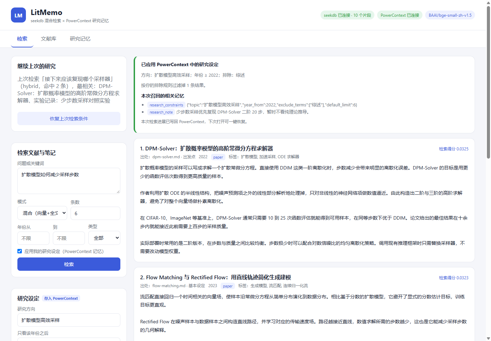
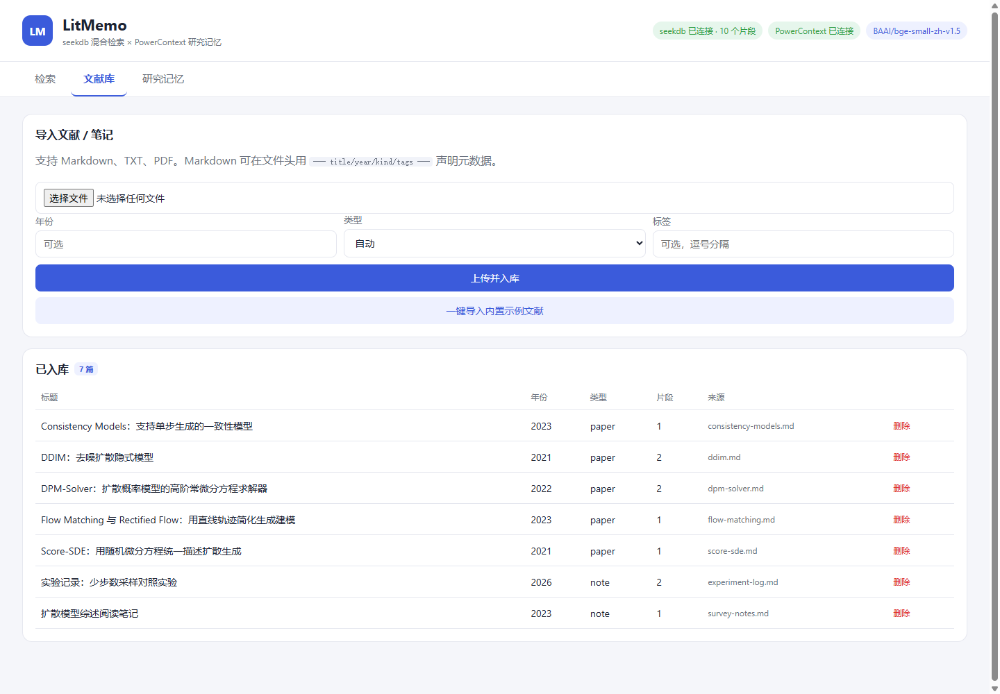
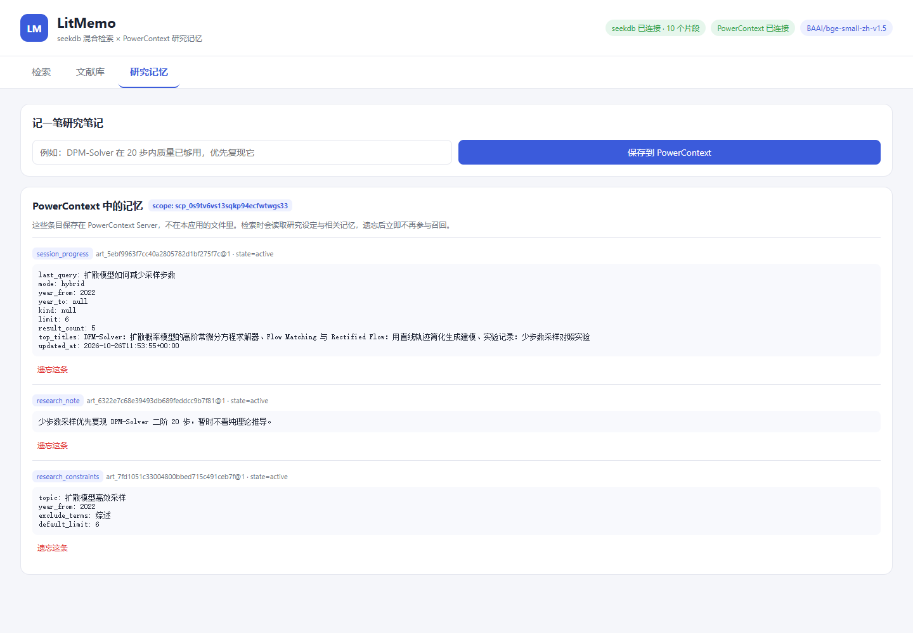

# LitMemo

LitMemo 是一个面向中文文献与阅读笔记的本地检索助手。它把分散的 Markdown、TXT、PDF 内容切成带出处的片段，用 seekdb 做向量、全文和混合检索，再用 PowerContext 保存研究设定、研究笔记和最近进展。

**公开展示网站：** <https://litmemo-research-vkx9bbhzdzt.qoder.zone>（完整检索应用按下方说明在本机运行）。

不需要外部 LLM 或商业 Embedding API。中文向量由本地 `BAAI/bge-small-zh-v1.5` 模型生成。

## 解决什么问题

- 文献和实验笔记分散，关键词搜索难以找到语义相近的内容。
- 每次换会话都要重复说明“研究方向、年份范围、排除内容”。
- 检索结果缺少出处，回到原文核对困难。
- 上次查到哪里、下一步复现什么，容易随会话结束而丢失。

## 核心功能

- 导入 Markdown、TXT、PDF；保留标题、页码或章节出处。
- seekdb 向量检索、全文检索、RRF 混合检索。
- 按年份和文献类型过滤。
- PowerContext 保存研究方向、起始年份、排除词和默认返回条数。
- 检索时召回相关研究笔记，并显示实际应用了哪些记忆。
- 自动保存最近查询与命中摘要，下次打开可恢复检索条件。
- 查看和遗忘记忆；遗忘后不再参与召回。

## 两个组件如何分工

| 组件 | 保存什么 | 在核心链路中做什么 |
| --- | --- | --- |
| seekdb | 文献分块、向量、全文索引、标题/年份/类型/出处等元数据 | 执行向量、全文、混合检索和结构化过滤 |
| PowerContext | 研究设定、研究笔记、最近检索进展 | 在检索前后读取和写回长期研究上下文，支持跨会话继续 |

两者不是互相替代：文献内容进入 seekdb，长期研究上下文进入 PowerContext。

```text
Markdown / TXT / PDF
        │
        ▼
解析、分块、本地中文向量化
        │
        ▼
     seekdb ◄──────── 查询、过滤、混合检索
        │
        ▼
带出处的检索结果 ◄── PowerContext 研究设定与相关笔记
        │
        ▼
最近查询与命中摘要 ──► PowerContext，供新会话恢复
```

## 界面

| 检索与记忆召回 | 文献库 | 研究记忆 |
| --- | --- | --- |
|  |  |  |

## 环境要求

- Python 3.11 或 3.12
- [uv](https://docs.astral.sh/uv/)
- Docker Desktop 或 Docker Engine
- PowerContext 1.4.0
- 首次下载中文向量模型时需要联网，之后使用本地模型缓存

Windows 使用 Docker 中的 seekdb Server，不使用嵌入式 seekdb。PowerContext 官方将 Windows 支持标为 experimental；本项目的显式记忆流程已在 Windows 11 实测通过。

## 快速启动

以下命令均在 `qoder/litmemo` 目录执行。

### 1. 启动 seekdb

```bash
docker compose up -d
```

默认连接为 `127.0.0.1:2881`、租户 `sys`、数据库 `test`、用户 `root`、空密码，仅用于本机开发。若 2881 已被占用，可复用已有 seekdb，或修改端口映射和 `.env`。

### 2. 安装并启动 PowerContext

```bash
uv tool install --force "powercontext[cli,server]==1.4.0"
powercontext server run --env-file deploy/powercontext.env.example
```

保持此终端运行。示例配置只监听 `127.0.0.1:8000`，关闭访问控制是为了本机演示，不应直接暴露到公网。LitMemo 会自动使用 PowerContext 的 default scope，无需额外模型 API。

### 3. 配置并启动 LitMemo

另开终端：

```bash
cp .env.example .env
uv sync --frozen
uv run uvicorn app.main:app --host 127.0.0.1 --port 8080
```

Windows PowerShell 可用：

```powershell
Copy-Item .env.example .env
uv sync --frozen
uv run uvicorn app.main:app --host 127.0.0.1 --port 8080
```

打开 <http://127.0.0.1:8080>，在“文献库”点击“一键导入内置示例文献”。

`.env` 已被 Git 忽略。示例配置不包含真实凭据；需要修改连接信息时只编辑本机 `.env`。

## 一键验证

三个服务均启动后运行：

```bash
uv run python scripts/verify.py
```

已导入示例、只想复验检索时：

```bash
uv run python scripts/verify.py --skip-import
```

脚本会实际验证：

1. seekdb 和 PowerContext 健康状态。
2. 7 篇原创示例文献的导入、分块与索引。
3. 向量、全文、混合三种检索。
4. 将“2022 年以后、排除综述”写入 PowerContext。
5. 再次检索时自动应用年份和排除词，并写回进展。
6. 保存“优先复现 DPM-Solver 二阶 20 步”的研究笔记。
7. 用“接下来应该复现哪个采样器”召回该笔记。
8. 重新读取跨会话检索进展。

成功时末尾输出“全部检查通过”。验证脚本会重置同名示例文献，并更新演示研究设定和进展。

## 手动验收样例

1. 导入示例，查询 `扩散模型如何减少采样步数`，分别切换三种检索模式。
2. 保存研究设定：方向 `扩散模型高效采样`，年份从 `2022`，排除词 `综述`。
3. 再次检索：结果应只包含 2022 年及以后内容，综述阅读笔记被排除，页面显示记忆应用情况。
4. 在“研究记忆”保存 `少步数采样优先复现 DPM-Solver 二阶 20 步`。
5. 查询 `接下来应该复现哪个采样器`，确认相关记忆区域召回该笔记。
6. 刷新页面，在“继续上次的研究”中恢复上次查询条件。

## 项目结构

```text
app/
  config.py       环境配置
  embeddings.py   本地中文向量模型
  ingest.py       文件解析、出处与分块
  store.py        seekdb 写入、索引、检索与过滤
  memory.py       PowerContext 记忆读写、召回与遗忘
  main.py         FastAPI API
  static/         无构建步骤的中文前端
samples/          7 篇原创中文演示文献与笔记
scripts/verify.py 端到端验证
deploy/           PowerContext 本机配置示例
docs/             界面截图与 Qoder 开发记录
```

## 数据与来源说明

- `samples/` 中文本均为本项目原创演示内容，不是论文原文，也不用于声称复现实验结果。
- 未复用第三方应用代码。
- 主要开源依赖包括 seekdb / pyseekdb、PowerContext、FastAPI、fastembed、pypdf 和 jieba，具体版本见 `pyproject.toml` 与 `uv.lock`。
- 向量模型为 `BAAI/bge-small-zh-v1.5`，仅在应用本机运行。

## 比赛材料

- Qoder 开发记录：[`docs/qoder-development.md`](docs/qoder-development.md)
- 可复现验证：[`scripts/verify.py`](scripts/verify.py)
- 真实界面截图：[`docs/screenshots/`](docs/screenshots/)
