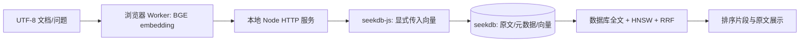

# Local Atlas · 端侧知识库

seekdb × 阶跃星辰赛题：在 Chrome / Edge 浏览器本地将中文文本编码为向量，交由本地 seekdb 存储，并由数据库完成向量与全文 RRF 混合检索。

本目录基于官方 `2026-competition-ecosystem` 分支的 `d647275c308e09b7b623f322a26f5c4e85734fb0` 开发。所有项目资产均位于 `stepfun/`。一页技术说明见 [TECHNICAL.md](TECHNICAL.md) 和 [PDF](output/pdf/technical-note.pdf)，真实测量原始数据见 [results/](results/)。

## 启动

需要 Node.js 22+、npm、Docker Compose，以及当前版本 Chrome / Edge。首次安装需联网下载 npm 包和约 167 MB 的三种精度模型；运行阶段不需要外部推理服务。建议为 Docker 分配至少 3 GB 可用内存和 8 GB 磁盘。

在仓库的 `stepfun` 目录执行：

```sh
npm ci
npm run models
npm run db:up
npm run build
npm start
```

打开 [http://localhost:3210](http://localhost:3210)。点击“加载模型”，选择自动模式；点击“导入示例”会创建对应精度的知识库并导入 24 份中文文档。输入“设备没有可用显卡接口时怎么办？”即可查看混合检索结果和完整原文。也可用 `＋` 新建知识库，再拖入 UTF-8 `.txt` / `.md` 文件或粘贴文字。

导入限制为每批 1–40 份文件、每批不超过 2 MiB、单文件不超过 1 MiB 且最多 2000 个片段；超限时请分批或拆文件，限制在模型计算前检查。

如需更改数据库连接，先从 `.env.example` 复制为 `.env`，填写后再启动。Windows PowerShell 使用 `Copy-Item .env.example .env`，macOS/Linux 使用 `cp .env.example .env`。`SEEKDB_PORT` 同时控制 Compose 的宿主机端口和应用连接端口；例如本机 2881 已被占用时设置 `SEEKDB_PORT=2882`。`PORT` 控制 Web 端口，默认 3210。服务仅监听本机回环地址。已有 seekdb 1.4.0 server 时可跳过 `db:up`，配置 `.env` 即可；数据库由应用自动创建。

开发模式运行 `npm run dev`。模型文件变化后重新执行 `npm run build`，生产服务读取 `dist/` 中的静态资源。`docker compose stop` 停止数据库但保留数据卷；不要删除数据卷来完成日常升级。

若网络需要代理，Node 24.5+ 可以通过 `HTTPS_PROXY` 和 `node --use-env-proxy scripts/download-models.js` 下载。Windows 示例：先设置 `$env:HTTPS_PROXY='http://127.0.0.1:7897'`，再执行上述命令。脚本从固定模型版本下载、校验 SHA-256，写入临时文件后原子替换，支持三次重试。离线设备可从已安装设备复制 `public/models/` 后构建。模型权重不提交 Git。

## 本地推理和量化

- 原模型：[BAAI/bge-small-zh-v1.5](https://huggingface.co/BAAI/bge-small-zh-v1.5)，MIT；ONNX 产物：[Xenova/bge-small-zh-v1.5](https://huggingface.co/Xenova/bge-small-zh-v1.5/tree/75c43b069aac4d136ba6bc1122f995fedcfd2781)，固定 commit `75c43b069aac4d136ba6bc1122f995fedcfd2781`。
- 使用该版本公开发布的 FP32、FP16 和 INT8 权重。INT8 的发布配置为 QInt8、per-channel、reduce-range，配置与校验和一并保留。**使用既有量化产物，无训练、无服务器编码。** 可选重新转换步骤见 [scripts/requantize.py](scripts/requantize.py)，重新转换文件不替换评测所用固定权重。
- Transformers.js 3.8.1 / 锁定的 ONNX Runtime Web；CLS 池化、L2 归一化、512 维；问题加中文 BGE 查询前缀。220 个 UTF-16 字符分块、40 字符重叠，最大输入 256 tokens，保留原文偏移。
- 自动模式显式指定 `device: 'webgpu', dtype: 'fp16'`，检查适配器的 `shader-f16`；不可用、初始化失败或首次预热失败则自动指定 `device: 'wasm', dtype: 'q8'`。界面始终显示实际后端、精度与降级原因。严格 GPU 实验配置在 GPU 不可用时报告失败，不将 WASM 成绩冒充为 GPU。
- Web Worker 执行文档和问题编码；模型加载一次复用，Cache API 缓存资源；长度排序后批处理并恢复原有顺序；默认批大小 8，WASM 最多 4 线程，使用 COOP/COEP。
- Worker 设置 `allowRemoteModels=false`；模型、运行时 `.wasm` 和模块均从本地站点提供。服务端不导入 embedding 运行时，没有云端推理路由。CSP 将运行阶段连接限制为同源。浏览器测试阻断所有外部请求；本机杀毒软件注入的请求单独记录并阻断。

## seekdb 和状态



每个知识库对应独立 SDK 集合 `atlas_<name>`：`id`、`document`、`embedding VECTOR(512)`、`metadata JSON`；向量索引为 HNSW/cosine（m=16、ef_construction=200、ef_search=64），全文索引为中文 ngram（2 字符）。SDK 管理集合物理表名。额外的 `stepfun_sources` 表保存完整原文，`stepfun_kbs` 保存模型指纹、精度、刷新状态和修订号，均位于 seekdb。

混合检索只调用 `collection.hybridSearch()`：全文 `$contains` 与 `knn.queryEmbeddings` 各取 20 候选，数据库 RRF（rank_constant=60、rank_window_size=20）后返回 K 条。K>20 时窗口相应扩大。浏览器保留数据库排序，不融合两路结果；语义检索选项也调用数据库的 `collection.query()`。

文件名和内容 SHA-256 构成文档 ID，片段序号构成记录 ID，upsert 使相同文件重试不重复。文件内容变化会成为新文档，保留已有版本。默认将所有选中文档的片段一起编码，SDK 每次最多写 64 块，全部写入后调用 `refresh_index()` 统一刷新，再转为 `ready`。正常查询不触发刷新。

状态顺序为 `writing → pending_refresh → ready`。持久化 `writing` 和待恢复文档 ID 后才开始写入；中断时搜索返回 409，重新导入该文件恢复；`pending_refresh` 可点击“刷新索引”恢复。单纯刷新不能将缺少数据的 `writing` 标为成功。批次中途失败时请先重传报错时正在处理的文件，再继续其他文件。

集合绑定模型 commit、池化、分块和精度。更改精度后应新建库，或切换回匹配的模型。页面切换知识库会清空结果并更新会话标记，旧请求无法覆盖新库结果。Node 对**整次**数据库操作全局串行化，保护 SDK 多条 SQL 之间的会话变量；本项目使用单个 Node 实例，不支持多个进程共享同一连接会话。

## 测试与实测复现

服务启动后，在同一目录运行：

```sh
npm test
npm run test:integration
npm run bench
```

测试默认使用本机已安装 Chrome；也可设置 `CHROME_PATH` 指向 Chrome/Edge，或先执行 `npx playwright install chromium`。`APP_URL` 可指定应用地址。界面“性能与质量实验”调用与 CLI 相同的代码，可以下载完整原始 JSON。实验创建独立 `bench_*` 集合，自动化功能测试创建 `it_*` / `ui_*` 集合，不修改已有知识库。

`data/evaluation.json` 包含人工编写的固定 24 份文档、21 个问题和二值相关性标注。各配置导入重复 3 次，第一轮为新增，后两轮为幂等 upsert；全部保留。每个问题重复 3 次，关闭查询向量缓存。按来源 ID 去重后计算 Recall@5 和 nDCG@5；这是工程回归用的小样本，不代表公开基准。数据库只返回 5 个片段，去重后不补抓候选。

报告单次模型加载/首次预热/缓存重新加载，以及导入和查询中位数。Worker 的 `inferenceMs` 包含分词、运行时调用、池化和归一化；`writeMs` 为服务端写入阶段；延迟表中数据库检索是 SDK 调用墙钟时间；端到端从浏览器发起问题到真实结果 DOM 绘制后双 rAF，包含编码、传输与显示等待。安装下载计时与浏览器从本地站点读取模型的计时分开记录，禁止相加当成推理延迟。不同配置复用相同数据、K、索引参数和设备；批大小与刷新策略有独立对照。

功能测试覆盖实际 WebGPU 和禁用 GPU 环境自动降级、界面导入/搜索/原文查看、重复导入、增量导入、并发跨库查询、精度不匹配拒绝和刷新前不可查询。中断恢复测试通过写入持久化 `writing` 标记模拟中断状态，验证搜索/刷新被阻止且重传后恢复；不将它表述为进程中途被强制终止的测试。

详细成绩、设备及计时说明见 [results/REPORT.md](results/REPORT.md)。本项目没有图片 embedding、答案生成或云端推理。超大语料与多用户公网部署超出当前单机迷你知识库的验证范围。

`node scripts/inspect-schema.js` 导出实际数据库 DDL。安装 Python `reportlab` 后，`python scripts/report.py` 可从已保存的实验结果重新生成 Markdown 和一页 PDF；此文档工具不属于应用运行依赖。`results/environment.json` 为本次人工记录的设备与配置，迁移设备重新测量时应同时更新。

## 文件入口

| 文件 | 用途 |
| --- | --- |
| `src/embedding.worker.js` | 本地模型、精度、后端与批处理 |
| `src/engine.js` | UI/评测共用的编码、导入、搜索路径 |
| `server/store.js` | seekdb 集合、混合检索、状态与刷新 |
| `src/benchmark.js` | 实测、质量评估与原始记录 |
| `data/model-lock.json` | 固定模型文件字节数与 SHA-256 |
| `compose.yaml` | 持久化本地 seekdb，镜像固定 digest |
| `results/benchmark.json` | 全部实测导入与查询记录 |
| `results/integration.json` | 两种真实后端功能验收记录 |

参考：[seekdb-js](https://github.com/oceanbase/seekdb-js)、[Transformers.js WebGPU 文档](https://huggingface.co/docs/transformers.js/guides/webgpu)。
